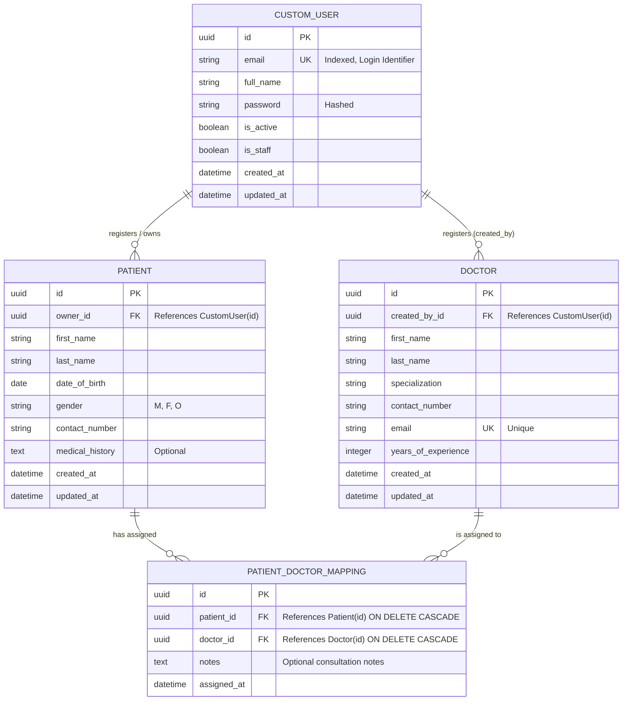
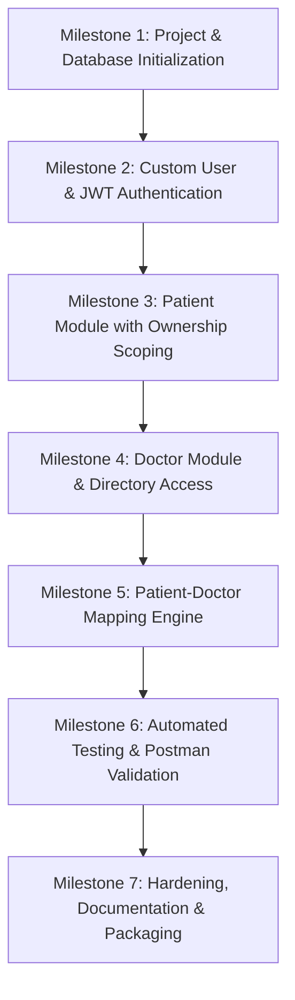

# Product Requirements Document (PRD)
## CareSync — Healthcare Backend REST API

| Metadata | Details |
| :--- | :--- |
| **Project Title** | CareSync Healthcare Management Backend API |
| **Document Version** | 1.0.0 |
| **Document Status** | Approved for Implementation |
| **Author / Roles** | Senior Product Manager, Business Analyst, Django Backend Architect |
| **Target Framework** | Django 5.x / Django REST Framework (DRF) 3.15+ |
| **Database** | PostgreSQL 15+ |
| **Authentication** | JSON Web Tokens (`djangorestframework-simplejwt`) |
| **Target Audience** | Backend Engineering Team, QA / Testers, Evaluators |

---

## 1. Document Overview, Purpose, Scope, and Goals

### 1.1 Purpose
This Product Requirements Document (PRD) defines the architectural, functional, security, and operational specifications for **CareSync**, a secure, multi-tenant-style Healthcare Backend REST API. The system enables healthcare personnel (users) to register, authenticate, manage patient profiles, browse a shared doctor directory, and establish relational assignments between patients and attending doctors.

### 1.2 Scope
* **In-Scope:**
  * Custom User Authentication with email-based credentials and JWT issuing/refreshing.
  * Patient Management: Full CRUD restricted strictly to the user who registered the patient (data isolation).
  * Doctor Directory: Shared catalog of registered medical specialists with standardized access controls.
  * Patient-Doctor Mappings: Association records linking patients to doctors with strict patient-ownership checks and duplicate assignment prevention.
  * Production-grade configuration templates, Postman integration test suites, and schema validation.
* **Out-of-Scope (Assignment Boundaries):**
  * Production HIPAA/HITECH certified compliance infrastructure.
  * Patient Electronic Health Records (EHR) deep history, clinical notes, lab results, and DICOM imaging.
  * Appointment scheduling, calendars, real-time messaging, and billing/invoicing workflows.
  * Multi-Factor Authentication (MFA/2FA) and email verification dispatchers (flagged as Phase 2 enhancements).

### 1.3 Project Goals
1. **Security & Data Isolation:** Ensure absolute isolation of patient records across distinct user accounts.
2. **API Predictability:** Adhere to strict RESTful conventions, consistent JSON response envelopes, and deterministic HTTP status codes.
3. **Architectural Cleanliness:** Implement a modular Django architecture adhering to clean-code principles, explicit data validation, and granular custom permissions.
4. **Developer Experience:** Deliver a beginner-friendly, fully testable, and demonstrable API with complete Postman coverage.

---

## 2. Problem Statement and Proposed Solution

### 2.1 Problem Statement
Small medical practices, clinics, and healthcare coordinators often rely on fragmented spreadsheets or disparate administrative tools to track patient records and specialist assignments. These ad-hoc methods introduce severe vulnerabilities:
* Unauthorized data exposure across care coordinators.
* Accidental duplicate assignments of doctors to the same patient.
* Lack of standardized programmatic interfaces for client applications (web, mobile, third-party portals).
* Inadequate credential security and unencrypted access tokens.

### 2.2 Proposed Solution
**CareSync** resolves this by delivering a lightweight, robust, headless REST API built on Python, Django REST Framework, and PostgreSQL. 
* **Tenant Isolation:** Every patient record is anchored to the authenticated user account (`owner`), guaranteeing that users can only view and mutate their own patients.
* **Relational Integrity:** A normalized relational database enforces referential integrity, preventing dangling mappings and duplicate doctor-patient links.
* **Stateless JWT Security:** Industry-standard SimpleJWT token management eliminates server-side session overhead while securing all private operational endpoints.

---

## 3. Target Users and User Stories

### 3.1 Target User Personas
* **Clinic Administrator / Healthcare Coordinator (Primary User):** Registers an account to onboard patients, review the roster of available physicians, and link doctors to patients under their jurisdiction.
* **Backend Auditor / Evaluation Assessor:** Evaluates API resilience, permission boundary enforcement, error-handling uniformity, and database constraints.

### 3.2 User Stories

| ID | Persona | User Story | Business Value |
| :--- | :--- | :--- | :--- |
| **US-01** | Healthcare Coordinator | As a coordinator, I want to register an account using my unique email and a strong password so that I have a secure workspace. | Establishes authenticated identity and credential protection. |
| **US-02** | Healthcare Coordinator | As a coordinator, I want to log in and receive an access token and refresh token so that I can authorize subsequent API requests. | Implements stateless, secure API communication. |
| **US-03** | Healthcare Coordinator | As a coordinator, I want to create and manage patient records so that I can keep track of patients under my direct care. | Centralizes patient record administration. |
| **US-04** | Healthcare Coordinator | As a coordinator, I want to ensure other coordinators cannot view, edit, or delete my patients so that patient confidentiality is guaranteed. | Enforces zero-trust horizontal data isolation. |
| **US-05** | Healthcare Coordinator | As a coordinator, I want to view a centralized registry of doctors so that I can discover specialists available for consultations. | Facilitates access to provider directories. |
| **US-06** | Healthcare Coordinator | As a coordinator, I want to assign a doctor to my patient and prevent accidental duplicate mappings so that care coordination remains accurate. | Eliminates redundancy and maintains relational consistency. |
| **US-07** | Healthcare Coordinator | As a coordinator, I want to view all doctors assigned to a specific patient so that I can monitor their care team. | Provides targeted relational insights. |
| **US-08** | Healthcare Coordinator | As a coordinator, I want to remove an assigned doctor from my patient when care concludes, without affecting other users' mappings. | Maintains dynamic, up-to-date assignment rosters. |

---

## 4. Functional Requirements & Acceptance Criteria

### 4.1 Module 1: Authentication & Account Management
* **FR-1.1: User Registration**
  * Must accept user's full name, email address, and password.
  * Must validate email uniqueness (case-insensitive).
  * Must enforce Django's default secure password validation (minimum length, numeric check, common password checks).
  * Must hash passwords via Django’s cryptographic hashing (PBKDF2 with SHA-256 by default).
  * *Acceptance Criteria:*
    * Sending valid credentials to `POST /api/auth/register/` returns HTTP `201 Created` with user ID, name, email, and created timestamp (password omitted).
    * Submitting an existing email returns HTTP `400 Bad Request` with `{"email": ["A user with that email already exists."]}`.
* **FR-1.2: User Login & Token Generation**
  * Must authenticate registered email and password.
  * Must issue a pair of JSON Web Tokens: short-lived `access` token and long-lived `refresh` token.
  * *Acceptance Criteria:*
    * Valid credentials return HTTP `200 OK` with `access` and `refresh` strings.
    * Invalid credentials return HTTP `401 Unauthorized` with an error description.
* **FR-1.3: Token Refresh**
  * Must accept a valid refresh token and return a new access token without re-entering credentials.
  * *Acceptance Criteria:*
    * Sending a valid refresh token to `POST /api/auth/token/refresh/` returns HTTP `200 OK` with a new `access` token.
    * An expired or malformed token returns HTTP `401 Unauthorized`.

### 4.2 Module 2: Patient Record Management
* **FR-2.1: Patient Creation**
  * Must accept patient demographic and baseline health details: `first_name`, `last_name`, `date_of_birth`, `gender`, `contact_number`, and optional `medical_history`.
  * Must automatically associate the newly created patient record with the `request.user` (the owner).
  * *Acceptance Criteria:*
    * Authenticated user sending valid data receives HTTP `201 Created` with the serialized record including `id` and `created_at`.
    * Unauthenticated calls return HTTP `401 Unauthorized`.
* **FR-2.2: Patient Listing**
  * Must return *only* the patients owned by the currently authenticated user (`queryset = Patient.objects.filter(owner=request.user)`).
  * *Acceptance Criteria:*
    * User A receives a list containing exclusively User A's patients. User B's patients are strictly omitted.
* **FR-2.3: Patient Detail Retrieval**
  * Must return the details of a patient matching the supplied primary key.
  * *Acceptance Criteria:*
    * Requesting an owned patient ID returns HTTP `200 OK`.
    * Requesting a non-existent ID returns HTTP `404 Not Found`.
    * Requesting a patient owned by *another* user returns HTTP `404 Not Found` (preferred to avoid ID enumeration leaks) or HTTP `403 Forbidden`.
* **FR-2.4: Patient Update**
  * Must allow partial (`PATCH`) or complete (`PUT`) updates to patient attributes.
  * Must prohibit transferring patient ownership to another user via payload.
  * *Acceptance Criteria:*
    * Updating an owned record returns HTTP `200 OK` with updated fields.
    * Attempting to update another user's patient returns HTTP `404 Not Found` / `403 Forbidden`.
* **FR-2.5: Patient Deletion**
  * Must delete the specified patient record and cascade-delete associated doctor mappings.
  * *Acceptance Criteria:*
    * Deleting an owned record returns HTTP `204 No Content`.
    * Attempting to delete another user's patient returns HTTP `404 Not Found` / `403 Forbidden`.

### 4.3 Module 3: Doctor Directory Management
* **Architectural Ownership Policy Decision:**
  > **Explicit Assumption & Policy Standard:**
  > In standard healthcare operations, physicians represent an institutional directory shared across departments and coordinators. 
  > * **Read Policy:** Globally readable by **any authenticated user** (`GET` /api/doctors/, `GET` /api/doctors/<id>/).
  > * **Write / Mutate Policy:** For this assignment, doctor records can be created by any authenticated staff member (`POST`), and updates/deletions (`PUT`, `DELETE`) are restricted to either the doctor record's creator (`created_by`) or staff/admin users. This guarantees consistent permission policies while preventing one coordinator from sabotaging or mutating doctor profiles used by other coordinators.
* **FR-3.1: Doctor Creation**
  * Must accept `first_name`, `last_name`, `specialization`, `contact_number`, `email`, and `years_of_experience`.
  * Must validate unique doctor email.
  * *Acceptance Criteria:*
    * Valid payload returns HTTP `201 Created`.
* **FR-3.2: Doctor Listing & Detail**
  * Authenticated users can list all active doctors and view details of any doctor.
  * *Acceptance Criteria:*
    * Authenticated `GET` returns HTTP `200 OK` with list/object.
* **FR-3.3: Doctor Update and Deletion**
  * Must validate that the requester is the authorized creator or admin.
  * *Acceptance Criteria:*
    * Authorized mutation returns HTTP `200 OK` (update) or HTTP `204 No Content` (deletion).
    * Unauthorized mutation by another coordinator returns HTTP `403 Forbidden`.

### 4.4 Module 4: Patient-Doctor Mappings
* **FR-4.1: Assign Doctor to Patient**
  * Accepts `patient` (ID) and `doctor` (ID) plus optional `notes`.
  * Must verify that the specified `patient` **belongs to the authenticated user**.
  * Must verify that the specified `doctor` exists in the system.
  * Must reject duplicate active assignments of the same doctor to the same patient.
  * *Acceptance Criteria:*
    * Valid assignment returns HTTP `201 Created` with mapping ID and nested/referenced entities.
    * Attempting to assign a doctor to a patient owned by another user returns HTTP `403 Forbidden` or `404 Not Found`.
    * Submitting an existing `(patient, doctor)` pair returns HTTP `400 Bad Request` or `409 Conflict` with message `"This doctor is already assigned to this patient."`.
* **FR-4.2: List Mappings**
  * Must list all patient-doctor mappings where the associated patient belongs to `request.user`.
  * *Acceptance Criteria:*
    * `GET /api/mappings/` returns HTTP `200 OK` with only mappings for the current user's patients.
* **FR-4.3: List Doctors for Specific Patient**
  * Must return doctor assignments for a given `patient_id`.
  * Must enforce ownership: `patient_id` must belong to `request.user`.
  * *Acceptance Criteria:*
    * Valid owned patient returns HTTP `200 OK` with assigned doctor array.
    * Patient belonging to another user returns HTTP `404 Not Found` / `403 Forbidden`.
* **FR-4.4: Remove Mapping**
  * Deletes a mapping record by `id`.
  * Must enforce ownership: the mapping's associated patient must be owned by `request.user`.
  * *Acceptance Criteria:*
    * Valid deletion returns HTTP `204 No Content`.
    * Attempting to delete another user's patient mapping returns HTTP `403 Forbidden` or `404 Not Found`.

---

## 5. Non-Functional Requirements (NFRs)

### 5.1 Security
* **Transport Layer:** In production/staging, all communication must be enforced over TLS 1.3 (HTTPS).
* **Credential Protection:** Passwords stored using PBKDF2 with SHA-256; raw passwords never logged or returned.
* **Token Hardening:** SimpleJWT access tokens configured with a 15-minute lifespan; refresh tokens configured with 1-to-7 day lifespan with rotation enabled.
* **Injection Defense:** All database interactions routed through Django ORM parameterized queries (preventing SQL injection).
* **Sanitization:** Input data serialized, stripped of dangerous script tags, and validated against strict schemas.

### 5.2 Performance & Efficiency
* **Response Latency:** 95% of API requests (`p95`) must resolve in under **150ms** under normal concurrency (excluding network transit).
* **Database Optimization:**
  * Foreign key indexes on `patient_id`, `doctor_id`, and `owner_id`.
  * Utilization of `select_related('patient', 'doctor')` on mapping queries to prevent `N+1` query cascades.

### 5.3 Reliability & Maintainability
* **Stateless Architecture:** Application nodes must remain completely stateless; session state is managed via client-held JWTs.
* **Atomic Transactions:** Patient-doctor mapping writes and critical multi-table mutations wrapped in `django.db.transaction.atomic()`.
* **Code Quality:** PEP 8 compliance, clear separation of concerns (Views, Serializers, Services, Permissions), and 100% type-hinted core functions.

### 5.4 Scalability
* **Database Connection Pooling:** Compatible with PostgreSQL connection poolers such as PgBouncer.
* **Multi-Worker Concurrency:** Ready for deployment behind Gunicorn / Uvicorn WSGI/ASGI servers with multiple worker processes.

---

## 6. Technology Stack & Justification

| Technology | Selected Tool | Justification & Role |
| :--- | :--- | :--- |
| **Language** | Python 3.11+ / 3.12 | Rich standard library, strong type hinting, widespread adoption in enterprise backends. |
| **Web Framework** | Django 5.x | Mature, batteries-included web framework with native ORM, migration engine, and security middlewares. |
| **API Framework** | Django REST Framework (DRF) 3.15+ | Industry standard for Django REST APIs; provides powerful serializers, viewsets, authentication hooks, and status code abstractions. |
| **Database** | PostgreSQL 15+ | Enterprise-grade ACID compliance, robust indexing (B-Tree, GIN), constraint enforcement, and high concurrency support. |
| **Authentication** | `djangorestframework-simplejwt` | Standards-compliant RFC 7519 JSON Web Token implementation; avoids server session storage and supports token blacklisting. |
| **Config Management** | `python-dotenv` or `django-environ` | Twelve-Factor App methodology compliance; externalizes secrets from the codebase. |
| **API Testing** | Postman & DRF `APITestCase` | Comprehensive functional validation, regression prevention, and automated grading/verification. |

---

## 7. Database Schema & Data Models

### 7.1 Entity Relationship Diagram (ERD)



### 7.2 Model Specifications & Constraints

#### 1. `User` (Custom User Model extending `AbstractBaseUser`, `PermissionsMixin`)
* `id`: `UUIDField(primary_key=True, default=uuid.uuid4, editable=False)`
* `email`: `EmailField(unique=True, max_length=255, db_index=True)`
* `full_name`: `CharField(max_length=255)`
* `is_active`: `BooleanField(default=True)`
* `is_staff`: `BooleanField(default=False)`
* `created_at`: `DateTimeField(auto_now_add=True)`
* `updated_at`: `DateTimeField(auto_now=True)`
* *Rules:* `USERNAME_FIELD = 'email'`, `REQUIRED_FIELDS = ['full_name']`.

#### 2. `Patient`
* `id`: `UUIDField(primary_key=True, default=uuid.uuid4, editable=False)`
* `owner`: `ForeignKey(User, on_delete=models.CASCADE, related_name='patients', db_index=True)`
* `first_name`: `CharField(max_length=100)`
* `last_name`: `CharField(max_length=100)`
* `date_of_birth`: `DateField()`
* `gender`: `CharField(max_length=10, choices=[('Male','Male'),('Female','Female'),('Other','Other')])`
* `contact_number`: `CharField(max_length=20)`
* `medical_history`: `TextField(blank=True, null=True)`
* `created_at`: `DateTimeField(auto_now_add=True)`
* `updated_at`: `DateTimeField(auto_now=True)`
* *Indexes:* `Index(fields=['owner', 'created_at'])`.

#### 3. `Doctor`
* `id`: `UUIDField(primary_key=True, default=uuid.uuid4, editable=False)`
* `created_by`: `ForeignKey(User, on_delete=models.SET_NULL, null=True, related_name='created_doctors')`
* `first_name`: `CharField(max_length=100)`
* `last_name`: `CharField(max_length=100)`
* `specialization`: `CharField(max_length=150, db_index=True)`
* `contact_number`: `CharField(max_length=20)`
* `email`: `EmailField(unique=True, max_length=255)`
* `years_of_experience`: `PositiveIntegerField(default=0)`
* `created_at`: `DateTimeField(auto_now_add=True)`
* `updated_at`: `DateTimeField(auto_now=True)`

#### 4. `PatientDoctorMapping`
* `id`: `UUIDField(primary_key=True, default=uuid.uuid4, editable=False)`
* `patient`: `ForeignKey(Patient, on_delete=models.CASCADE, related_name='doctor_mappings', db_index=True)`
* `doctor`: `ForeignKey(Doctor, on_delete=models.CASCADE, related_name='patient_mappings', db_index=True)`
* `notes`: `TextField(blank=True, null=True)`
* `assigned_at`: `DateTimeField(auto_now_add=True)`
* *Constraints:*
  * Unique Constraint: `UniqueConstraint(fields=['patient', 'doctor'], name='unique_patient_doctor_assignment')`
  * Prevents a doctor from being assigned more than once to the same patient.

---

## 8. Detailed API Endpoint Specifications

### Standard Response Headers
* `Content-Type: application/json`
* Authenticated requests must provide: `Authorization: Bearer <access_token>`

---

### 8.1 Authentication Endpoints

#### 8.1.1 Register User
* **URL:** `/api/auth/register/`
* **Method:** `POST`
* **Auth Required:** No
* **Request Payload:**
```json
{
  "full_name": "Dr. Sarah Jenkins",
  "email": "sarah.jenkins@clinic.org",
  "password": "SecurePassword123!"
}
```
* **Success Response (`201 Created`):**
```json
{
  "id": "e6a218f2-8c90-4e1b-85d1-efdb5e87a201",
  "full_name": "Dr. Sarah Jenkins",
  "email": "sarah.jenkins@clinic.org",
  "created_at": "2026-10-22T10:15:30Z"
}
```
* **Validation Rules & Error Responses:**
  * Email must be valid format and not already registered (`400 Bad Request`).
  * Password must satisfy length (>= 8 chars) and complexity rules (`400 Bad Request`).
```json
{
  "email": ["A user with that email already exists."],
  "password": ["This password is too short. It must contain at least 8 characters."]
}
```

#### 8.1.2 Login User
* **URL:** `/api/auth/login/`
* **Method:** `POST`
* **Auth Required:** No
* **Request Payload:**
```json
{
  "email": "sarah.jenkins@clinic.org",
  "password": "SecurePassword123!"
}
```
* **Success Response (`200 OK`):**
```json
{
  "access": "eyJhbGciOiJIUzI1NiIsInR5cCI6IkpXVCJ9.eyJ0b2tlbl90eXBlIjoiYWNjZXNzIiwiZXhwIjoxNzc2ODY1OTAwLCJ1c2VyX2lkIjoiZTZhMjE4ZjItOGM5MC00ZTFiLTg1ZDEtZWZkYjVlODdhMjAxIn0.abcdef...",
  "refresh": "eyJhbGciOiJIUzI1NiIsInR5cCI6IkpXVCJ9.eyJ0b2tlbl90eXBlIjoicmVmcmVzaCIsImV4cCI6MTc3NzQ3MDcwMCwidXNlcl9pZCI6ImU2YTIxOGYyLThjOTAtNGUxYi04NWQxLWVmZGI1ZTg3YTIwMSJ9.fedcba..."
}
```
* **Error Response (`401 Unauthorized`):**
```json
{
  "detail": "No active account found with the given credentials"
}
```

#### 8.1.3 Token Refresh
* **URL:** `/api/auth/token/refresh/`
* **Method:** `POST`
* **Auth Required:** No
* **Request Payload:**
```json
{
  "refresh": "eyJhbGciOiJIUzI1NiIsInR5cCI6IkpXVCJ9..."
}
```
* **Success Response (`200 OK`):**
```json
{
  "access": "eyJhbGciOiJIUzI1NiIsInR5cCI6IkpXVCJ9.new_access_token..."
}
```

---

### 8.2 Patient Management Endpoints

#### 8.2.1 Create Patient
* **URL:** `/api/patients/`
* **Method:** `POST`
* **Auth Required:** Yes (`Bearer <token>`)
* **Request Payload:**
```json
{
  "first_name": "Eleanor",
  "last_name": "Vance",
  "date_of_birth": "1988-04-12",
  "gender": "Female",
  "contact_number": "+1-555-019-2834",
  "medical_history": "Hypertension, penicillin allergy."
}
```
* **Success Response (`201 Created`):**
```json
{
  "id": "c71a39f0-29c8-472e-8395-5858cfd78901",
  "first_name": "Eleanor",
  "last_name": "Vance",
  "date_of_birth": "1988-04-12",
  "gender": "Female",
  "contact_number": "+1-555-019-2834",
  "medical_history": "Hypertension, penicillin allergy.",
  "created_at": "2026-10-22T10:30:00Z",
  "updated_at": "2026-10-22T10:30:00Z"
}
```
* **Validation Rules:**
  * `first_name`, `last_name`, `date_of_birth`, `gender`, `contact_number` are required.
  * `date_of_birth` must not be in the future.
  * `gender` must be one of `['Male', 'Female', 'Other']`.

#### 8.2.2 List Owned Patients
* **URL:** `/api/patients/`
* **Method:** `GET`
* **Auth Required:** Yes
* **Success Response (`200 OK`):**
```json
[
  {
    "id": "c71a39f0-29c8-472e-8395-5858cfd78901",
    "first_name": "Eleanor",
    "last_name": "Vance",
    "date_of_birth": "1988-04-12",
    "gender": "Female",
    "contact_number": "+1-555-019-2834",
    "medical_history": "Hypertension, penicillin allergy.",
    "created_at": "2026-10-22T10:30:00Z",
    "updated_at": "2026-10-22T10:30:00Z"
  }
]
```
*(Only returns patients created by the authenticated user.)*

#### 8.2.3 Retrieve Patient Details
* **URL:** `/api/patients/<id>/`
* **Method:** `GET`
* **Auth Required:** Yes
* **Success Response (`200 OK`):**
```json
{
  "id": "c71a39f0-29c8-472e-8395-5858cfd78901",
  "first_name": "Eleanor",
  "last_name": "Vance",
  "date_of_birth": "1988-04-12",
  "gender": "Female",
  "contact_number": "+1-555-019-2834",
  "medical_history": "Hypertension, penicillin allergy.",
  "created_at": "2026-10-22T10:30:00Z",
  "updated_at": "2026-10-22T10:30:00Z"
}
```
* **Error Response (`404 Not Found`):**
```json
{
  "detail": "No Patient matches the given query."
}
```
*(Returned if patient does not exist OR if owned by another user.)*

#### 8.2.4 Update Patient Record
* **URL:** `/api/patients/<id>/`
* **Method:** `PUT` / `PATCH`
* **Auth Required:** Yes
* **Request Payload (`PATCH` example):**
```json
{
  "contact_number": "+1-555-999-4422",
  "medical_history": "Hypertension, penicillin allergy, mild asthma."
}
```
* **Success Response (`200 OK`):**
```json
{
  "id": "c71a39f0-29c8-472e-8395-5858cfd78901",
  "first_name": "Eleanor",
  "last_name": "Vance",
  "date_of_birth": "1988-04-12",
  "gender": "Female",
  "contact_number": "+1-555-999-4422",
  "medical_history": "Hypertension, penicillin allergy, mild asthma.",
  "created_at": "2026-10-22T10:30:00Z",
  "updated_at": "2026-10-22T10:45:12Z"
}
```
* **Error Response (`404 Not Found` or `403 Forbidden`):**
  If patient belongs to another user.

#### 8.2.5 Delete Patient Record
* **URL:** `/api/patients/<id>/`
* **Method:** `DELETE`
* **Auth Required:** Yes
* **Success Response (`204 No Content`):** *Empty body.*
* **Error Response (`404 Not Found`):** If ID not found or belongs to another user.

---

### 8.3 Doctor Directory Endpoints

#### 8.3.1 Create Doctor
* **URL:** `/api/doctors/`
* **Method:** `POST`
* **Auth Required:** Yes
* **Request Payload:**
```json
{
  "first_name": "Marcus",
  "last_name": "Brody",
  "specialization": "Cardiology",
  "contact_number": "+1-555-432-1100",
  "email": "marcus.brody@hospital.org",
  "years_of_experience": 14
}
```
* **Success Response (`201 Created`):**
```json
{
  "id": "d12f9801-44bb-4e2b-b91c-7281fa019234",
  "first_name": "Marcus",
  "last_name": "Brody",
  "specialization": "Cardiology",
  "contact_number": "+1-555-432-1100",
  "email": "marcus.brody@hospital.org",
  "years_of_experience": 14,
  "created_at": "2026-10-22T09:00:00Z",
  "updated_at": "2026-10-22T09:00:00Z"
}
```
* **Error Response (`400 Bad Request`):**
```json
{
  "email": ["A doctor with this email already exists."],
  "years_of_experience": ["Ensure this value is greater than or equal to 0."]
}
```

#### 8.3.2 List All Doctors
* **URL:** `/api/doctors/`
* **Method:** `GET`
* **Auth Required:** Yes (Authenticated users can view global directory)
* **Success Response (`200 OK`):**
```json
[
  {
    "id": "d12f9801-44bb-4e2b-b91c-7281fa019234",
    "first_name": "Marcus",
    "last_name": "Brody",
    "specialization": "Cardiology",
    "contact_number": "+1-555-432-1100",
    "email": "marcus.brody@hospital.org",
    "years_of_experience": 14
  }
]
```

#### 8.3.3 Retrieve Doctor Detail
* **URL:** `/api/doctors/<id>/`
* **Method:** `GET`
* **Auth Required:** Yes
* **Success Response (`200 OK`):** Returns doctor object.
* **Error Response (`404 Not Found`):** Doctor not found.

#### 8.3.4 Update Doctor
* **URL:** `/api/doctors/<id>/`
* **Method:** `PUT` / `PATCH`
* **Auth Required:** Yes (Creator or Staff)
* **Success Response (`200 OK`):** Returns updated doctor object.
* **Error Response (`403 Forbidden`):**
```json
{
  "detail": "You do not have permission to modify this doctor profile."
}
```

#### 8.3.5 Delete Doctor
* **URL:** `/api/doctors/<id>/`
* **Method:** `DELETE`
* **Auth Required:** Yes (Creator or Staff)
* **Success Response (`204 No Content`):** Empty body.
* **Error Response (`403 Forbidden`):** Permission denied.

---

### 8.4 Patient-Doctor Mapping Endpoints

#### 8.4.1 Assign Doctor to Patient
* **URL:** `/api/mappings/`
* **Method:** `POST`
* **Auth Required:** Yes
* **Request Payload:**
```json
{
  "patient": "c71a39f0-29c8-472e-8395-5858cfd78901",
  "doctor": "d12f9801-44bb-4e2b-b91c-7281fa019234",
  "notes": "Referred for initial cardiac assessment."
}
```
* **Success Response (`201 Created`):**
```json
{
  "id": "fa3b2180-60b1-47ec-a489-38290ef43211",
  "patient": "c71a39f0-29c8-472e-8395-5858cfd78901",
  "patient_name": "Eleanor Vance",
  "doctor": "d12f9801-44bb-4e2b-b91c-7281fa019234",
  "doctor_name": "Dr. Marcus Brody",
  "specialization": "Cardiology",
  "notes": "Referred for initial cardiac assessment.",
  "assigned_at": "2026-10-22T11:00:00Z"
}
```
* **Validation & Error Responses:**
  * **Patient Ownership Violation (`403 Forbidden` or `400 Bad Request`):**
    ```json
    {
      "patient": ["You can only assign doctors to patients you own."]
    }
    ```
  * **Duplicate Assignment (`400 Bad Request` or `409 Conflict`):**
    ```json
    {
      "non_field_errors": ["This doctor is already assigned to this patient."]
    }
    ```
  * **Doctor / Patient Non-Existent (`400 Bad Request`):**
    ```json
    {
      "doctor": ["Invalid pk \"00000000-0000-0000-0000-000000000000\" - object does not exist."]
    }
    ```

#### 8.4.2 List All Mappings for Current User's Patients
* **URL:** `/api/mappings/`
* **Method:** `GET`
* **Auth Required:** Yes
* **Success Response (`200 OK`):**
```json
[
  {
    "id": "fa3b2180-60b1-47ec-a489-38290ef43211",
    "patient": "c71a39f0-29c8-472e-8395-5858cfd78901",
    "patient_name": "Eleanor Vance",
    "doctor": "d12f9801-44bb-4e2b-b91c-7281fa019234",
    "doctor_name": "Dr. Marcus Brody",
    "specialization": "Cardiology",
    "notes": "Referred for initial cardiac assessment.",
    "assigned_at": "2026-10-22T11:00:00Z"
  }
]
```

#### 8.4.3 List Doctors Assigned to Specific Patient
* **URL:** `/api/mappings/<patient_id>/`
* **Method:** `GET`
* **Auth Required:** Yes
* **Success Response (`200 OK`):**
```json
{
  "patient_id": "c71a39f0-29c8-472e-8395-5858cfd78901",
  "patient_name": "Eleanor Vance",
  "assigned_doctors": [
    {
      "mapping_id": "fa3b2180-60b1-47ec-a489-38290ef43211",
      "doctor_id": "d12f9801-44bb-4e2b-b91c-7281fa019234",
      "doctor_name": "Dr. Marcus Brody",
      "specialization": "Cardiology",
      "assigned_at": "2026-10-22T11:00:00Z",
      "notes": "Referred for initial cardiac assessment."
    }
  ]
}
```
* **Error Response (`404 Not Found`):**
  If `patient_id` does not exist or does not belong to the authenticated user.

#### 8.4.4 Remove Mapping
* **URL:** `/api/mappings/<id>/`
* **Method:** `DELETE`
* **Auth Required:** Yes
* **Success Response (`204 No Content`):** Empty body.
* **Error Response (`404 Not Found` or `403 Forbidden`):**
  Returned if mapping does not exist or if the mapping links to a patient owned by another user.

---

## 9. Authentication & Authorization Strategy

### 9.1 Password Hashing
* Uses Django's cryptographically secure `make_password()` / `check_password()` pipeline.
* Algorithm: PBKDF2 with SHA-256 (Django default: 720,000 iterations in Django 5).
* Passwords are salted per-user and never stored or returned in plaintext.

### 9.2 JWT Configuration (`djangorestframework-simplejwt`)
* **Signature Algorithm:** `HS256` (or `RS256` in production).
* **Token Lifespans:**
  * `ACCESS_TOKEN_LIFETIME = timedelta(minutes=15)` (mitigates stolen token replay).
  * `REFRESH_TOKEN_LIFETIME = timedelta(days=7)`.
* **Token Rotation:**
  * `ROTATE_REFRESH_TOKENS = True` (a new refresh token is issued when the old one is used).
  * `BLACKLIST_AFTER_ROTATION = True` (requires `rest_framework_simplejwt.token_blacklist` app to invalidate retired tokens).
* **Header Authorization Format:**
  * `Authorization: Bearer <access_token>`

### 9.3 Authorization & Ownership Enforcement Strategy
Two layers of defense must be enacted in Django REST Framework:
1. **QuerySet Scoping (Layer 1 - Data Retrieval Isolation):**
   * In `PatientViewSet.get_queryset()`:
     ```python
     def get_queryset(self):
         return Patient.objects.filter(owner=self.request.user)
     ```
   * Ensures filtered queries (`list`, `retrieve`, `update`, `destroy`) automatically yield `404 Not Found` for records belonging to another tenant, preventing object enumeration.
2. **Object-Level Permissions (Layer 2 - Explicit Mutation Guard):**
   * Custom permission class `IsOwner`:
     ```python
     class IsOwner(permissions.BasePermission):
         def has_object_permission(self, request, view, obj):
             # For Patient instances
             if hasattr(obj, 'owner'):
                 return obj.owner == request.user
             # For Mapping instances
             if hasattr(obj, 'patient'):
                 return obj.patient.owner == request.user
             return False
     ```
3. **Serializer Validation (Layer 3 - Ingestion Guard):**
   * In `PatientDoctorMappingSerializer.validate_patient()`:
     ```python
     def validate_patient(self, value):
         if value.owner != self.context['request'].user:
             raise serializers.ValidationError("You do not have permission to map this patient.")
         return value
     ```

---

## 10. Validation & Error-Handling Standards

### 10.1 Uniform Error Envelope Standard
To ensure client applications can parse errors predictably, DRF's default exception handler is standardized to return a structured JSON response:

```json
{
  "success": false,
  "error": {
    "code": "VALIDATION_ERROR",
    "message": "Invalid input provided.",
    "details": {
      "email": [
        "Enter a valid email address."
      ]
    }
  }
}
```

### 10.2 HTTP Status Code Matrix

| Status Code | Meaning | Use Case |
| :--- | :--- | :--- |
| `200 OK` | Success | Successful `GET`, `PUT`, `PATCH`, or `login` request. |
| `201 Created` | Resource Created | Successful `register`, `patient` creation, `doctor` creation, `mapping`. |
| `204 No Content`| Deletion Success | Successful `DELETE` of a patient, doctor, or mapping. |
| `400 Bad Request`| Validation Failure | Malformed JSON, missing mandatory fields, duplicate constraints. |
| `401 Unauthorized`| Authentication Missing/Invalid | Missing Bearer token, expired JWT, invalid login credentials. |
| `403 Forbidden` | Access Denied | Authenticated user attempting to modify another user's resource. |
| `404 Not Found` | Entity Missing | Invalid resource ID or entity belonging to another user. |
| `409 Conflict` | Conflict | Duplicate mapping attempt when treated as state conflict. |
| `500 Server Error`| Internal Bug | Unhandled system exception (must log trace, never expose in body). |

### 10.3 Sensitive Data Protection in Errors
* Production configurations (`DEBUG = False`) must suppress internal tracebacks, SQL statements, and server path information.
* Logs must scrub passwords, tokens, and patient personal health data.

---

## 11. Environment Variables & Secure Configuration

### 11.1 Security Best Practices
* **Zero Hardcoded Secrets:** Credentials, keys, and DB passwords must never be committed to Git.
* **`.gitignore` Rules:**
  ```gitignore
  .env
  .env.local
  *.pyc
  __pycache__/
  db.sqlite3
  staticfiles/
  media/
  ```

### 11.2 Environment Variables Specification (`.env.example`)

```bash
# ==============================================================================
# CareSync Environment Configuration Template
# Copy this file to '.env' and populate with local/production values.
# NEVER commit the actual '.env' file to version control.
# ==============================================================================

# Django Security
DEBUG=False
SECRET_KEY=generate-a-strong-random-50-char-secret-key-here
ALLOWED_HOSTS=127.0.0.1,localhost,api.caresync.internal

# Database Configuration (PostgreSQL)
DB_NAME=caresync_db
DB_USER=caresync_user
DB_PASSWORD=SecurePostgresPassword123!
DB_HOST=localhost
DB_PORT=5432

# SimpleJWT Settings
JWT_ACCESS_TOKEN_LIFETIME_MINUTES=15
JWT_REFRESH_TOKEN_LIFETIME_DAYS=7
JWT_SIGNING_KEY=optional-separate-signing-key-or-falls-back-to-secret-key

# CORS Configuration (Optional if decoupled frontend is used)
CORS_ALLOWED_ORIGINS=http://localhost:3000,http://127.0.0.1:3000
```

---

## 12. Suggested Django Project Architecture

A clean, modular structure segregating domain boundaries into focused Django apps:

```
CareSync/
│
├── manage.py
├── .env.example
├── .gitignore
├── README.md
├── requirements.txt
│
├── config/                          # Django Project Configuration Root
│   ├── __init__.py
│   ├── asgi.py
│   ├── settings.py                  # Environment-driven settings
│   ├── urls.py                      # Global URL router
│   ├── wsgi.py
│   └── exceptions.py                # Custom unified exception handler
│
├── apps/
│   ├── accounts/                    # Custom User & Authentication
│   │   ├── __init__.py
│   │   ├── admin.py
│   │   ├── apps.py
│   │   ├── models.py                # CustomUser model
│   │   ├── serializers.py           # Register, UserSummary serializers
│   │   ├── urls.py                  # /api/auth/ URLs
│   │   ├── views.py                 # RegisterView, Login (TokenObtainPairView)
│   │   └── tests/
│   │       ├── __init__.py
│   │       └── test_auth.py
│   │
│   ├── patients/                    # Patient Domain App
│   │   ├── __init__.py
│   │   ├── admin.py
│   │   ├── apps.py
│   │   ├── models.py                # Patient model
│   │   ├── permissions.py           # IsPatientOwner permission
│   │   ├── serializers.py           # PatientSerializer
│   │   ├── urls.py                  # /api/patients/ URLs
│   │   ├── views.py                 # PatientViewSet
│   │   └── tests/
│   │       ├── __init__.py
│   │       └── test_patients.py
│   │
│   ├── doctors/                     # Doctor Domain App
│   │   ├── __init__.py
│   │   ├── admin.py
│   │   ├── apps.py
│   │   ├── models.py                # Doctor model
│   │   ├── permissions.py           # IsDoctorCreatorOrReadOnly permission
│   │   ├── serializers.py           # DoctorSerializer
│   │   ├── urls.py                  # /api/doctors/ URLs
│   │   ├── views.py                 # DoctorViewSet
│   │   └── tests/
│   │       ├── __init__.py
│   │       └── test_doctors.py
│   │
│   └── mappings/                    # Patient-Doctor Mapping Domain App
│       ├── __init__.py
│       ├── admin.py
│       ├── apps.py
│       ├── models.py                # PatientDoctorMapping model
│       ├── permissions.py           # IsMappingPatientOwner permission
│       ├── serializers.py           # MappingCreateSerializer, MappingDetailSerializer
│       ├── urls.py                  # /api/mappings/ URLs
│       ├── views.py                 # MappingViewSet, PatientDoctorsListView
│       └── tests/
│           ├── __init__.py
│           └── test_mappings.py
│
└── postman/                         # Testing Artifacts
    ├── CareSync_API.postman_collection.json
    └── CareSync_Local.postman_environment.json
```

---

## 13. Database Migrations & PostgreSQL Setup Requirements

### 13.1 Local PostgreSQL Setup Steps
1. **PostgreSQL Service Verification:** Ensure PostgreSQL server (v15+) is active on `localhost:5432`.
2. **Database & Role Provisioning:**
   ```sql
   CREATE DATABASE caresync_db;
   CREATE USER caresync_user WITH ENCRYPTED PASSWORD 'SecurePostgresPassword123!';
   GRANT ALL PRIVILEGES ON DATABASE caresync_db TO caresync_user;
   ALTER DATABASE caresync_db OWNER TO caresync_user;
   ```
3. **Database Extension (UUID):**
   ```sql
   \c caresync_db;
   CREATE EXTENSION IF NOT EXISTS "uuid-ossp";
   ```

### 13.2 Migration Strategy
* Before generating initial migrations, configure `AUTH_USER_MODEL = 'accounts.CustomUser'` in `settings.py`.
* **Execution Sequence:**
  ```bash
  python manage.py makemigrations accounts
  python manage.py makemigrations patients
  python manage.py makemigrations doctors
  python manage.py makemigrations mappings
  python manage.py migrate
  ```
* **Migration Rules:**
  * Every schema change must have a corresponding, reviewed migration file.
  * Never edit applied migrations in a shared or production environment.

---

## 14. Comprehensive Testing Strategy

A multi-tiered automated test suite using DRF's `APITestCase` ensures complete test coverage.

### 14.1 Positive Test Cases
1. **User Registration:** Register user with valid payload $\rightarrow$ `201 Created`, user exists in DB.
2. **User Login:** Authenticate registered user $\rightarrow$ `200 OK`, valid JWT tokens returned.
3. **Create Patient:** Authenticated user posts valid patient data $\rightarrow$ `201 Created`, owner is set to `request.user`.
4. **List Patients:** User retrieves patients $\rightarrow$ `200 OK`, all returned patients have `owner == request.user`.
5. **Create Doctor:** User posts valid doctor data $\rightarrow$ `201 Created`.
6. **List Doctors:** User queries `/api/doctors/` $\rightarrow$ `200 OK`, receives full list of doctors.
7. **Create Mapping:** User assigns existing doctor to owned patient $\rightarrow$ `201 Created`.
8. **List Specific Patient's Doctors:** User requests `/api/mappings/<patient_id>/` $\rightarrow$ `200 OK`, returns assigned doctor list.
9. **Delete Mapping:** User deletes mapping for their own patient $\rightarrow$ `204 No Content`.

### 14.2 Negative & Boundary Test Cases
1. **Duplicate User Registration:** Registering with existing email $\rightarrow$ `400 Bad Request`.
2. **Weak Password Registration:** Submitting a 4-character password $\rightarrow$ `400 Bad Request`.
3. **Invalid Login Credentials:** Incorrect password or non-existent email $\rightarrow$ `401 Unauthorized`.
4. **Unauthenticated API Access:** Calling `/api/patients/` without Bearer token $\rightarrow$ `401 Unauthorized`.
5. **Expired JWT Access:** Submitting an expired token $\rightarrow$ `401 Unauthorized` (`token_not_valid`).

### 14.3 Multi-Tenant Permission Isolation Tests (Critical)
1. **Cross-Tenant Patient Retrieval:** User A attempts `GET /api/patients/<User_B_patient_id>/` $\rightarrow$ `404 Not Found`.
2. **Cross-Tenant Patient Mutation:** User A attempts `PUT/PATCH /api/patients/<User_B_patient_id>/` $\rightarrow$ `404 Not Found`.
3. **Cross-Tenant Patient Deletion:** User A attempts `DELETE /api/patients/<User_B_patient_id>/` $\rightarrow$ `404 Not Found`.
4. **Cross-Tenant Mapping Hijack:** User A attempts to create a mapping assigning a doctor to User B's patient $\rightarrow$ `400 Bad Request` or `403 Forbidden`.
5. **Cross-Tenant Mapping Listing:** User A calls `GET /api/mappings/<User_B_patient_id>/` $\rightarrow$ `404 Not Found`.
6. **Cross-Tenant Mapping Deletion:** User A attempts to delete a mapping belonging to User B's patient $\rightarrow$ `404 Not Found` or `403 Forbidden`.

### 14.4 Relational Constraint Tests
1. **Duplicate Doctor-Patient Assignment:** Creating mapping for already-assigned `(patient_id, doctor_id)` $\rightarrow$ `400 Bad Request` (integrity constraint handled gracefully).
2. **Non-Existent Foreign Keys:** Assigning a fake UUID for patient or doctor $\rightarrow$ `400 Bad Request`.

---

## 15. Postman Collection Requirements & Test Scenarios

### 15.1 Collection Setup & Environment Variables
* **Environment Variables:**
  * `baseUrl`: `http://127.0.0.1:8000`
  * `userA_token`: *(populated dynamically via test script)*
  * `userA_refresh`: *(populated dynamically)*
  * `userB_token`: *(populated dynamically)*
  * `patient_id`: *(stored dynamically from Patient Creation)*
  * `doctor_id`: *(stored dynamically from Doctor Creation)*
  * `mapping_id`: *(stored dynamically from Mapping Creation)*

### 15.2 Automated Postman Script Examples
* **Login Test Script (Sets Token Automatically):**
  ```javascript
  pm.test("Status code is 200 OK", function () {
      pm.response.to.have.status(200);
      var jsonData = pm.response.json();
      pm.environment.set("userA_token", jsonData.access);
      pm.environment.set("userA_refresh", jsonData.refresh);
  });
  ```
* **Create Patient Test Script:**
  ```javascript
  pm.test("Patient created successfully", function () {
      pm.response.to.have.status(201);
      var jsonData = pm.response.json();
      pm.environment.set("patient_id", jsonData.id);
  });
  ```

### 15.3 Execution Sequence in Postman Runner
1. `Auth - Register User A` $\rightarrow$ Expect `201`
2. `Auth - Login User A` $\rightarrow$ Expect `200` (Extract `userA_token`)
3. `Auth - Register User B` $\rightarrow$ Expect `201`
4. `Auth - Login User B` $\rightarrow$ Expect `200` (Extract `userB_token`)
5. `Patients - Create Patient (User A)` $\rightarrow$ Expect `201` (Extract `patient_id`)
6. `Patients - List Patients (User A)` $\rightarrow$ Expect `200` (Count == 1)
7. `Patients - List Patients (User B)` $\rightarrow$ Expect `200` (Count == 0, verifies isolation)
8. `Patients - Attempt Get User A Patient with User B Token` $\rightarrow$ Expect `404`
9. `Doctors - Create Doctor` $\rightarrow$ Expect `201` (Extract `doctor_id`)
10. `Doctors - List Doctors` $\rightarrow$ Expect `200`
11. `Mappings - Assign Doctor to Patient (User A)` $\rightarrow$ Expect `201` (Extract `mapping_id`)
12. `Mappings - Duplicate Assignment Attempt (User A)` $\rightarrow$ Expect `400`
13. `Mappings - Attempt Assign Doctor to User A Patient using User B Token` $\rightarrow$ Expect `400` / `403`
14. `Mappings - List Assigned Doctors for Patient` $\rightarrow$ Expect `200`
15. `Mappings - Delete Mapping (User A)` $\rightarrow$ Expect `204`
16. `Patients - Delete Patient (User A)` $\rightarrow$ Expect `204`

---

## 16. Implementation Milestones (Beginner-Friendly Order)



### Detailed Breakdown

* **Milestone 1: Project Setup & PostgreSQL Configuration**
  * Initialize virtual environment (`venv`).
  * Install dependencies: `django`, `djangorestframework`, `djangorestframework-simplejwt`, `psycopg2-binary`, `python-dotenv`.
  * Set up PostgreSQL database and user.
  * Initialize `.env` and create `config/settings.py` integration.

* **Milestone 2: Custom User & Authentication System**
  * Create `accounts` app.
  * Implement `CustomUser` model inheriting `AbstractBaseUser`.
  * Configure SimpleJWT settings.
  * Create `/api/auth/register/`, `/api/auth/login/`, and `/api/auth/token/refresh/`.
  * Run migrations and verify token generation.

* **Milestone 3: Patient Module with Ownership Scoping**
  * Create `patients` app.
  * Implement `Patient` model with foreign key to `User`.
  * Implement `PatientSerializer` (automatically assigning `owner` from request context).
  * Build `PatientViewSet` overriding `get_queryset()` to filter by `request.user`.
  * Wire URLs to `/api/patients/`.

* **Milestone 4: Doctor Module**
  * Create `doctors` app.
  * Implement `Doctor` model with unique email and specialization fields.
  * Implement `DoctorSerializer` and `DoctorViewSet`.
  * Add permission policies (authenticated view, restricted update/delete).
  * Wire URLs to `/api/doctors/`.

* **Milestone 5: Patient-Doctor Mapping Engine**
  * Create `mappings` app.
  * Implement `PatientDoctorMapping` model with `UniqueConstraint`.
  * Implement validation: verify `patient.owner == request.user`.
  * Implement endpoints: `POST /api/mappings/`, `GET /api/mappings/`, `GET /api/mappings/<patient_id>/`, `DELETE /api/mappings/<id>/`.

* **Milestone 6: Testing & Validation**
  * Write unit and integration test suites covering happy paths, edge cases, and cross-user isolation.
  * Execute `python manage.py test` and achieve 100% test pass rate.
  * Export Postman collection and environment files.

* **Milestone 7: Production Hardening & Documentation**
  * Audit `.env.example`, ensure `DEBUG=False` readiness.
  * Add standardized exception handling.
  * Prepare final README and API documentation.

---

## 17. Assumptions, Constraints, Risks, and Out-of-Scope Features

### 17.1 Assumptions
1. **Single Identity Role:** Users act as healthcare staff/coordinators who manage patients. Patients themselves do not log into this API (B2B / internal clinic tool model).
2. **Doctor Directory Sharing:** Doctors are institutional resources visible to all authenticated coordinators, preventing redundant doctor entries across users.
3. **Soft vs. Hard Deletions:** For this assignment scope, cascading hard deletes are utilized; in enterprise environments, soft deletes (`is_deleted=True`) would be mandated for medical records.

### 17.2 Constraints
* Implementation must strictly adhere to Django 5 and Django REST Framework.
* No frontend application code is included; the API must be 100% verifiable via HTTP clients (Postman/cURL).
* Database must be PostgreSQL (not SQLite) to ensure production-like constraint evaluation and concurrency behavior.

### 17.3 Risks & Mitigations
* **Risk: IDOR (Insecure Direct Object Reference) Vulnerabilities.**
  * *Mitigation:* Never query objects solely by URL ID. Always scope QuerySets by `owner=request.user`.
* **Risk: Duplicate Mapping Race Conditions.**
  * *Mitigation:* Rely on database-level `UniqueConstraint` rather than solely application-level checks, wrapped in atomic transactions.
* **Risk: Secret Leakage.**
  * *Mitigation:* Strict `.gitignore` validation and use of `.env.example`.

### 17.4 Real-World Production Gaps (Educational Context vs. Real Medical Systems)
This assignment provides foundational backend patterns. A production-ready medical platform requires:
1. **HIPAA / GDPR Compliance:** Stringent Business Associate Agreements (BAAs), Field-Level Encryption (FLE) for PHI (Protected Health Information) at rest using AES-256.
2. **Immutable Audit Trails:** Immutable append-only audit logs recording every access and read of patient data (e.g., who viewed Eleanor Vance's record at what timestamp).
3. **Role-Based Access Control (RBAC):** Fine-grained permission matrices (Chief Medical Officer, Registered Nurse, Billing Specialist, System Admin).
4. **MFA / SSO:** Mandatory SAML / OAuth2 / TOTP multi-factor authentication for healthcare workers.

---

## 18. Definition of Done (DoD) & Final Submission Checklist

### 18.1 Definition of Done (DoD)
A feature or milestone is marked **Done** only when:
* [ ] Database models and constraints are applied and verified via PostgreSQL migrations.
* [ ] DRF serializers thoroughly validate mandatory fields, data types, and boundary conditions.
* [ ] Endpoints return documented HTTP status codes and uniform JSON response envelopes.
* [ ] Horizontal tenant isolation is enforced and validated by negative tests.
* [ ] Automated test suite executes cleanly with zero failures (`python manage.py test`).
* [ ] Postman collection runs sequentially without manual parameter tampering.
* [ ] No credentials or secrets exist in git history.

### 18.2 Final Submission Checklist

| Category | Checklist Item | Status |
| :--- | :--- | :--- |
| **Authentication** | Custom User model implemented with email as primary login | [ ] |
| | Password complexity validated and hashed via PBKDF2 | [ ] |
| | `/api/auth/register/` creates user and returns `201 Created` | [ ] |
| | `/api/auth/login/` returns JWT access and refresh tokens | [ ] |
| | `/api/auth/token/refresh/` successfully issues new access token | [ ] |
| **Patients** | `POST /api/patients/` creates patient and attaches `owner=request.user` | [ ] |
| | `GET /api/patients/` returns ONLY patients owned by requester | [ ] |
| | `GET /api/patients/<id>/` returns `404` if owned by another user | [ ] |
| | `PUT /api/patients/<id>/` updates owned record; forbids unauthorized updates | [ ] |
| | `DELETE /api/patients/<id>/` deletes owned record; cascades cleanly | [ ] |
| **Doctors** | `POST /api/doctors/` creates doctor record with unique email | [ ] |
| | `GET /api/doctors/` and `GET /api/doctors/<id>/` accessible to all authenticated users | [ ] |
| | Doctor update and delete endpoints enforce clear permission policy | [ ] |
| **Mappings** | `POST /api/mappings/` links doctor to patient | [ ] |
| | Mapping creation rejects patients not owned by authenticated user | [ ] |
| | Mapping creation rejects duplicate assignments (`UniqueConstraint`) | [ ] |
| | `GET /api/mappings/` lists only mappings for requester's patients | [ ] |
| | `GET /api/mappings/<patient_id>/` returns assigned doctors; checks ownership | [ ] |
| | `DELETE /api/mappings/<id>/` deletes mapping; checks patient ownership | [ ] |
| **Code & Config** | Zero hardcoded secrets; `.env.example` provided | [ ] |
| | `DEBUG=False` configuration verified | [ ] |
| | PostgreSQL database migrations complete and error-free | [ ] |
| **Testing** | Automated tests cover positive, negative, and permission cases | [ ] |
| | Postman collection and environment files exported and tested | [ ] |
| | Comprehensive `README.md` with setup and execution instructions | [ ] |
